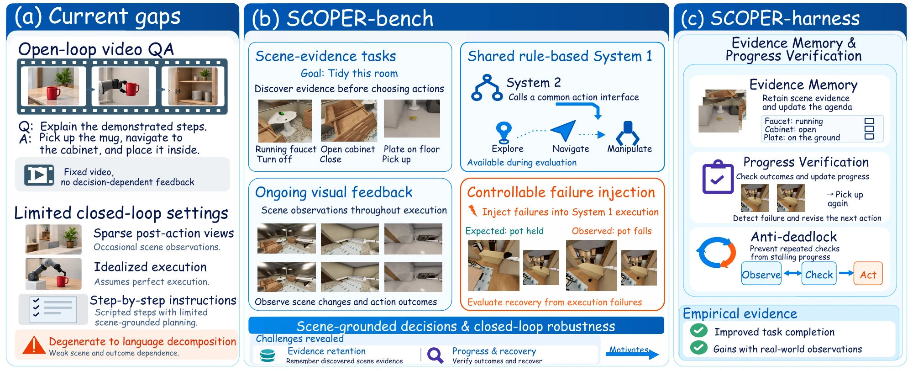
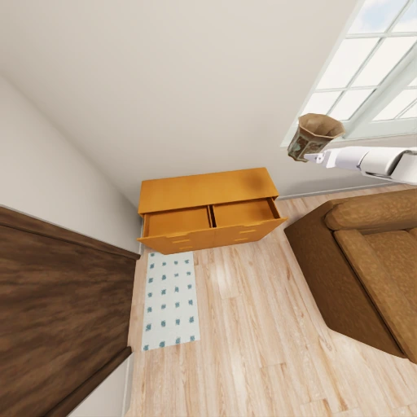
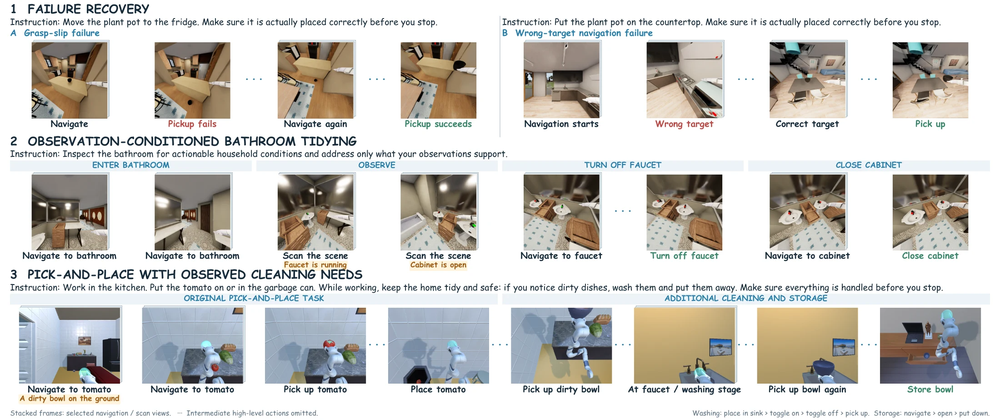
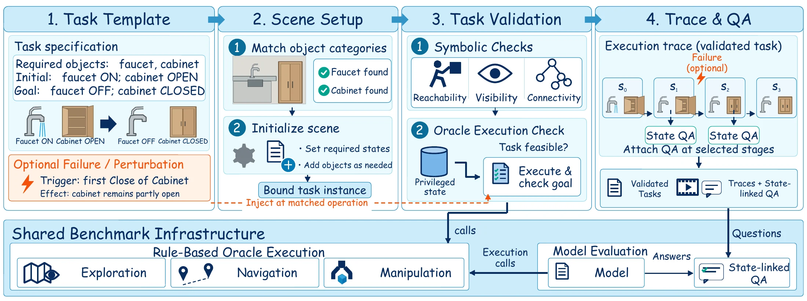
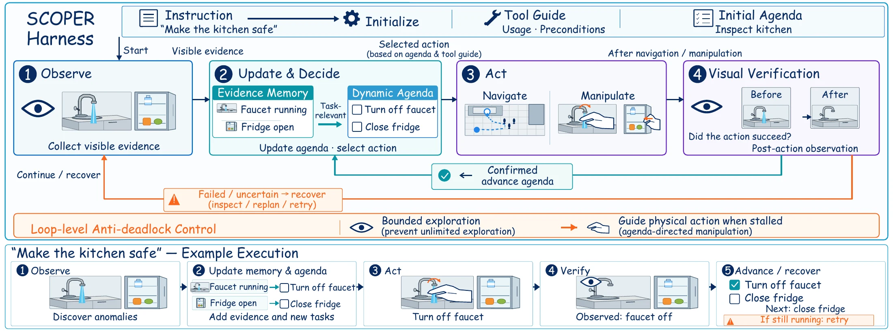

<div align="center">

# SCOPER

### Towards a Systematic Study of Embodied System 2<br>over Full Task Execution Cycles

**Yuxi Wei**<sup>1,2</sup> · **Ye Fang**<sup>2,3</sup> · **Shuai Yang**<sup>4</sup><br>
**Tong Wu**<sup>2,3</sup> · **Tai Wang**<sup>2,*</sup> · **Xiaojuan Qi**<sup>1,*</sup>

<sup>1</sup>The University of Hong Kong · <sup>2</sup>Morphi Robot<br>
<sup>3</sup>Fudan University · <sup>4</sup>Shanghai Jiao Tong University<br>
<sup>*</sup>Co-corresponding authors

**[Paper PDF](https://vfishc.github.io/scoper/downloads/SCOPER_preprint.pdf)** · **[Project website](https://vfishc.github.io/scoper/)** · **[Hugging Face dataset](https://huggingface.co/datasets/vfishc/SCOPER)** · **[Visual gallery](https://vfishc.github.io/scoper/#gallery)**

**870 tasks · 2 simulators · 35 base templates · 3,450 situated questions**

</div>

<p align="center">
  <a href="https://vfishc.github.io/scoper/">
    
  </a>
</p>
<p align="center"><em>Observe, plan, execute, verify and recover—throughout the full task cycle.</em></p>

**An action request is not proof of success.** An embodied agent must discover relevant scene conditions, choose what to do, and check whether its actions worked. SCOPER brings these decisions together through high-level goals, ongoing visual feedback and controlled execution failures.

| SCOPER-bench | SCOPER-harness | What the evaluation reveals |
| --- | --- | --- |
| Validated tasks across ProcTHOR and BEHAVIOR, covering routine execution, observation-dependent decisions, recovery and composition. | Training-free evidence memory, a dynamic agenda, progress verification and bounded recovery using the same model backbone. | Where agents lose evidence, repeat unsuccessful actions, stop too early or exhaust the action budget. |

> **Release scope:** generation, oracle execution and direct-VLM evaluation are available through the unified CLI. The selected harness library is included, but its unified simulator-CLI integration is not included in this release.

**Explore:** [Execution examples](#execution-examples) · [Benchmark](#benchmark-at-a-glance) · [Harness](#harness-design) · [Get started](#get-started) · [Installation](#installation-and-usage) · [Assets](#download-assets) · [Citation](#citation)

## Execution examples

<table>
  <tr>
    <td align="center" width="33%"><br><b>1. Attempt placement</b></td>
    <td align="center" width="33%"><br><b>2. Notice the failure</b></td>
    <td align="center" width="33%"><br><b>3. Reacquire and continue</b></td>
  </tr>
</table>

Selected BEHAVIOR demonstration frames; intermediate actions are omitted. These illustrate the task rather than establish a particular model's performance.

<p align="center">
  <a href="docs/downloads/figures/trace_figure_sample.pdf">
    
  </a>
</p>

The task can change as evidence arrives: an injected failure requires recovery, an inspection identifies what needs attention, and a placement task can reveal an additional cleaning obligation.

**[Browse all nine simulation examples and real-observation figures →](https://vfishc.github.io/scoper/#gallery)**

## Benchmark at a glance

| | ProcTHOR | BEHAVIOR |
| --- | ---: | ---: |
| Task episodes | 450 | 420 |
| Attached situated QA | 1,819 | 1,631 |
| Two-subtask composites | 50 | 50 |
| Three-subtask composites | 50 | 50 |

Four task groups test **routine execution**, **observation-dependent decisions**, **failure recovery** and **composite execution**. The model receives public instructions, tool vocabulary and images—not private simulator state or the teacher's plan. Atomic / two-subtask / three-subtask budgets are 24 / 36 / 48 calls, including QA answers.

<details>
<summary><b>See the task construction and validation pipeline</b></summary>

<p align="center"></p>

Templates specify object roles, initial conditions, goals and optional events. Compatible layouts are initialized, checked and executed by a privileged teacher. Trace-aligned QA probes states, relations, outcomes, issues, obligations and progress.

</details>

## Harness design

<p align="center">
  <a href="docs/downloads/figures/method.pdf"></a>
</p>

**Evidence Memory** retains observations relevant to future decisions. A **dynamic agenda** tracks requirements and newly discovered needs. **Progress Verification** checks action effects, while **recovery and anti-deadlock controls** keep execution moving. The method is training-free but uses additional inference calls.

**[Explore model comparisons, ablations and per-template results →](https://vfishc.github.io/scoper/#evaluation)**

## Get started

For a lightweight structural check (Python 3.11+; no simulator launch):

```bash
git clone https://github.com/vfishc/scoper.git
cd scoper
python -m pip install -e .
scoper-procthor check-bank task_bank/procthor
scoper-behavior check-bank task_bank/behavior
```

For real generation, rendering or model evaluation, complete the [environment installation](#install-environments) and [asset downloads](#download-assets) below. The [Hugging Face dataset](https://huggingface.co/datasets/vfishc/SCOPER) mirrors the bundled task bank; simulator geometry and model weights are obtained from their original publishers.

<details>
<summary><b>Release contents, validation and known boundaries</b></summary>

| Release contents | Status |
| --- | --- |
| ProcTHOR / BEHAVIOR generation, scene matching, initialization, atomic tools and oracle | Included |
| Direct VLM evaluation, public Binding, overlay QA and metrics | Included |
| Generated task bank | 450 ProcTHOR + 420 BEHAVIOR; 1,819 + 1,631 attached questions |
| Selected harness library | Included; unified simulator CLI integration is not included |
| Official simulator assets, runtimes and model weights | Download separately as described below |
| Full oracle videos / per-frame archives | Not included; optional separate artifact release |

The recorded 1.3.0 acceptance has 343 passing tests and 12 subtests. Both bank structural checks were rerun for this publication staging directory. Earlier isolated Qwen/oracle checks were bounded runtime tests; this preparation does not certify full-bank score reproduction or a fresh-machine installation.

The standalone storage-inspection template replaces the former native-QA task. Existing composite children remain unchanged. The new inspection task's stricter visual-evidence acceptance is still a separate validation item. Historical paper tables are not new evaluations of this replacement bank.


</details>

---

## Installation and usage

SCOPER packages task generation, scene matching and initialization, atomic tools,
oracle execution, direct-VLM evaluation, Binding and overlay QA for ProcTHOR and
BEHAVIOR. The selected EMAP harness is included as a separate library; the unified
CLI runs direct VLM. Harness simulator integration is outside this release's scope.

## Independent backend workflows

This distribution is a clean source snapshot: no Git object database, commit
history, branches, worktrees, historical run directories or development caches
are included. Upstream revision identifiers below are dependency pins needed
for installation, not a copy of our development history.

ProcTHOR and BEHAVIOR have separate workflow modules, commands, configuration
files, task banks and output directories. Install and run them in separate
environments if desired. They share task schemas, Binding, QA and metrics in
`benchmark/common`; this avoids diverging evaluation rules. This is one Python
distribution with independently selectable backends, not two duplicated packages.

| Workflow | ProcTHOR | BEHAVIOR |
| --- | --- | --- |
| Command | `scoper-procthor` / `python -m scoper.procthor` | `scoper-behavior` / `python -m scoper.behavior` |
| Configuration example | `configs/procthor.example.yaml` | `configs/behavior.example.yaml` |
| Workflow code | `src/scoper/workflows/procthor.py` | `src/scoper/workflows/behavior.py` |
| Simulator implementation | `src/scoper/benchmark/procthor/` | `src/scoper/benchmark/behavior/` |
| Bank | `task_bank/procthor/` | `task_bank/behavior/` |
| Required external runtime | AI2-THOR + PRIOR | OmniGibson + BDDL + Isaac Sim |

Both commands expose `generate`, `oracle`, `evaluate`, `check-bank`, `summarize`
and `doctor`. Backend-scoped commands do not accept `--backend`. Help, bank checks
and reporting do not start a simulator. GPU libraries are loaded when the
corresponding runtime is requested. Harness execution is separate and is not
implicitly enabled by either benchmark entrypoint.

### ProcTHOR workflow

```bash
cp configs/procthor.example.yaml configs/procthor.yaml
# Set renderer, PRIOR cache, model and output-cache paths.
scoper-procthor --config configs/procthor.yaml doctor
scoper-procthor --config configs/procthor.yaml generate \
  --layout prior://procthor-10k/train/1883 --template dynamic_state_change.json \
  --output /path/to/outputs/procthor/candidates --limit 2
scoper-procthor --config configs/procthor.yaml oracle \
  --bank task_bank/procthor/tasks_with_qa.json --task-id TASK_ID \
  --output /path/to/outputs/procthor/oracle
scoper-procthor --config configs/procthor.yaml evaluate \
  --bank-dir task_bank/procthor --output /path/to/outputs/procthor/evaluation --limit 450
scoper-procthor check-bank task_bank/procthor
scoper-procthor summarize --bank task_bank/procthor/tasks_with_qa.json \
  --results /path/to/outputs/procthor/evaluation/results.jsonl \
  --output /path/to/outputs/procthor/summary.json
```

### BEHAVIOR workflow

```bash
cp configs/behavior.example.yaml configs/behavior.yaml
# Set official asset, model and output-cache paths.
scoper-behavior --config configs/behavior.yaml doctor
scoper-behavior --config configs/behavior.yaml generate \
  --layout Ihlen_1_int --template static_simple.json \
  --output /path/to/outputs/behavior/candidates --limit 2
scoper-behavior --config configs/behavior.yaml oracle \
  --bank task_bank/behavior/tasks_with_qa.json --task-id TASK_ID \
  --output /path/to/outputs/behavior/oracle
scoper-behavior --config configs/behavior.yaml evaluate \
  --bank-dir task_bank/behavior --output /path/to/outputs/behavior/evaluation --limit 420
scoper-behavior check-bank task_bank/behavior
scoper-behavior summarize --bank task_bank/behavior/tasks_with_qa.json \
  --results /path/to/outputs/behavior/evaluation/results.jsonl \
  --output /path/to/outputs/behavior/summary.json
```

Replace `TASK_ID` with an ID in the chosen bank. Candidate generation, oracle
admission and evaluation are separate stages; a newly generated candidate is
not automatically admitted. The installation and download instructions below
apply before either workflow. The generic `scoper --backend` selection remains
available as `scoper <command> --backend <name>` where applicable, as documented below.

## Package contents

| Path | Purpose |
| --- | --- |
| `src/scoper/benchmark/procthor` | ProcTHOR generation, tools, teacher policy, oracle and evaluation |
| `src/scoper/benchmark/behavior` | BEHAVIOR initialization, symbolic checks, tools, rendering and evaluation |
| `src/scoper/benchmark/common` | Shared Binding, QA and metrics |
| `src/scoper/agents` | Model adapters |
| `src/scoper/harness` | Selected harness implementation |
| `task_bank/` | Generated tasks and coupled sidecars |
| `configs/` | Portable path configuration |
| `third_party/patches/` | Required upstream runtime patch |
| `tests/` | Regression tests |

The bank contains **450 ProcTHOR and 420 BEHAVIOR episodes**. Each backend includes
`tasks_with_qa.json`, `binding.json`, `oracle_reference.json`,
`asset_requirements.json` and `manifest.json`. Initial states, spawned-object
configuration and QA are included. Sidecars are coupled to the exact task-bank
hash; never mix versions. The standalone inspection template replaces the
previous native-QA template. Existing composite children remain unchanged.

## Install environments

Use Linux and Python 3.11, with an NVIDIA GPU and working Vulkan/EGL drivers.
BEHAVIOR additionally requires an Isaac Sim compatible machine. The two backends
may use separate environments. From this source directory:

```bash
conda create -n scoper-procthor python=3.11 -y
conda activate scoper-procthor
python -m pip install 'torch==2.7.0' 'torchvision==0.22.0' --index-url https://download.pytorch.org/whl/cu128
python -m pip install -e '.[procthor,local,render]' 'ai2thor==5.0.0' 'transformers==5.5.4' 'numpy==1.26.0'
```

Observed working versions also include Pillow 11.3.0 and PyYAML 6.0.2.
These are tested versions, not a complete dependency lockfile or certification
for every clean machine. For CPU regression tests, install `'.[test]'` and run
`python -m pytest -q`.

### BEHAVIOR / OmniGibson

Download [BEHAVIOR-1K](https://github.com/StanfordVL/BEHAVIOR-1K) separately.
Use the pinned revision and included patch:

```bash
git clone https://github.com/StanfordVL/BEHAVIOR-1K.git /path/to/BEHAVIOR-1K
cd /path/to/BEHAVIOR-1K
git checkout b9c66728f423a20d77883cda8803424029581657
git apply /path/to/scoper/third_party/patches/behavior-runtime.patch
./setup.sh --omnigibson --bddl
```

Follow that revision's setup prompts in a dedicated environment, including its
Isaac Sim installation and license acceptance. The tested runtime is Isaac Sim
5.1.0.0. Then install SCOPER with `pip install -e '/path/to/scoper[local,render]'`
in the resulting environment and check Torch/Transformers compatibility.
A renderer-only environment is insufficient for local Qwen evaluation.
Use the [official installation guide](https://behavior.stanford.edu/getting_started/installation.html)
for platform prerequisites; prefer the pinned checkout's script when newer
documentation differs.

## Download assets

| Resource | Source | Bundled? |
| --- | --- | --- |
| Our tasks, initial states, Binding, QA and oracle references | `task_bank/` | Yes |
| Official BEHAVIOR scenes, objects and robot meshes | Upstream download utilities | No |
| ProcTHOR house definitions | PRIOR / ProcTHOR-10K | No |
| AI2-THOR Unity executable | AI2-THOR CloudRendering | No |
| Model weights | Model publisher | No |
| Oracle videos and full frames | Separate optional research artifacts | No |
| Conda environments, CUDA and simulator SDKs | Upstream installers | No |

### BEHAVIOR assets

The pinned upstream setup script supports `--omnigibson --bddl --dataset`;
this can also download challenge data beyond this benchmark. Alternatively,
after installation use its asset utilities:

```python
from omnigibson.utils.asset_utils import (
    download_omnigibson_robot_assets,
    download_behavior_1k_assets,
)
download_omnigibson_robot_assets()
download_behavior_1k_assets()
```

Read and accept the upstream license yourself. Point SCOPER's `behavior_assets`
to the downloaded `behavior-1k-assets` directory. Configure OmniGibson's own
asset location through its upstream setup as well: SCOPER does not relocate
robot assets. Required scene/model names are in `asset_requirements.json`.

### ProcTHOR house pool

The [PRIOR loader](https://github.com/allenai/prior) obtains
[ProcTHOR-10K](https://github.com/allenai/procthor-10k):
10,000 train, 1,000 validation and 1,000 test layouts.

```python
from pathlib import Path
import prior
root = Path("/path/to/procthor-cache")
prior.BASE_DIR = str(root / ".prior")
prior.DATASET_DIR = str(root / ".prior" / "datasets")
dataset = prior.load_dataset("procthor-10k")
print({s: len(dataset[s]) for s in ("train", "val", "test")})
```

Set `procthor_prior_home` to the same root. Preserve the downloaded revision and
cache for repeatability; do not replace house definitions during experiments.
SCOPER defaults to offline house loading after this separate download step.

### AI2-THOR renderer

Use CloudRendering commit `f0825767cd50d69f666c7f282e54abfe58f1e917`.
On a GPU machine with working drivers and network access, a one-time startup
downloads and initializes the official binary:

```python
from ai2thor.controller import Controller
from ai2thor.platform import CloudRendering
controller = Controller(
    platform=CloudRendering,
    commit_id="f0825767cd50d69f666c7f282e54abfe58f1e917",
    scene="FloorPlan1",
)
controller.stop()
```

Locate the executable under `~/.ai2thor/releases/` and set
`procthor_executable` to that file. Subsequent runs use the local executable.
See [AI2-THOR documentation](https://ai2thor.allenai.org/ithor/documentation/)
for renderer prerequisites.

### Qwen weights

For the tested [Qwen3.5-9B](https://huggingface.co/Qwen/Qwen3.5-9B):

```bash
python -m pip install huggingface_hub
hf download Qwen/Qwen3.5-9B --local-dir /path/to/models/Qwen3.5-9B
```

Set `model` to that directory. Other adapters use `--agent-config`; their
dependencies and hardware requirements differ. Keep API credentials outside
tracked files.

## Configure

```bash
cp configs/local.example.yaml configs/local.yaml
# Replace placeholder paths in local.yaml.
scoper --config configs/local.yaml doctor --backend procthor
scoper --config configs/local.yaml doctor --backend behavior
```

Relative paths resolve beside the YAML file. `resource_root` is this extracted
distribution. `cache_root` configures TMPDIR, XDG and Torch extension caches;
simulator-specific caches may additionally follow upstream settings.
The CLI does not delete caches automatically. Monitor free space and clean
caches only after their workers stop; never delete task banks or results.

`doctor` checks paths and installed modules, not actual GPU rendering.
Set `CUDA_VISIBLE_DEVICES` before launching BEHAVIOR or a local model.
ProcTHOR's `--gpu` selects its graphics device; graphics and CUDA enumeration
can differ, so check device assignment in deployment logs.

## Unified commands

`scoper` and `python -m scoper` are equivalent. Each subcommand supports
`--help`. Output directories must be new.

### Evaluate with direct VLM

```bash
scoper --config configs/local.yaml evaluate --backend procthor \
  --bank-dir task_bank/procthor --output /path/to/results/procthor-qwen --limit 450
scoper --config configs/local.yaml evaluate --backend behavior \
  --bank-dir task_bank/behavior --output /path/to/results/behavior-qwen --limit 420
```

Defaults: standard VLM, multiple observation images (up to eight), no privileged
policy metadata, 24 steps for atomic tasks and 36/48 for two/three-child
composites. Scan is not limited to once. The default episode limit is one:
specify full-bank limits intentionally. Use repeated `--task-id` for subsets and
`--dry-run` to inspect resolved arguments without loading the simulator/model.

BEHAVIOR layout reuse is enabled by default, subject to compatible configuration
and safe-reset checks. Reschedule a task requiring a fresh process in a fresh
worker; never bypass the reset-safety check. This command is a single worker,
not the historical cluster queue manager. GPU sharding and infrastructure retry
scheduling belong to the deployment layer.

Outputs include results, per-step text diagnostics and the resolved agent
configuration. This wrapper does not enable frame capture.

### Generate candidates

```bash
scoper --config configs/local.yaml generate --backend procthor \
  --layout prior://procthor-10k/train/1883 --template dynamic_state_change.json \
  --output /path/to/procthor-candidates --limit 2
scoper --config configs/local.yaml generate --backend behavior \
  --layout Ihlen_1_int --template static_simple.json \
  --output /path/to/behavior-candidates --limit 2
```

The bounded generator profiles the layout, matches requirements and writes
candidate JSON and diagnostics. BEHAVIOR also runs symbolic admission and
symbolic teacher checks. No match is a normal rejection. Candidates still need
actual oracle admission, frozen object-asset assignments and rebuilt bank
sidecars before becoming evaluation episodes.

### Run the oracle

Choose an ID from the bank:

```bash
scoper --config configs/local.yaml oracle --backend procthor \
  --bank task_bank/procthor/tasks_with_qa.json --task-id TASK_ID \
  --output /path/to/oracle-output
```

Use `--backend behavior` and its bank for BEHAVIOR. The command records video and
execution records and exits unsuccessfully when real rendering or execution
does not pass.

### Check data and summarize

```bash
scoper check-bank task_bank/procthor
scoper check-bank task_bank/behavior
scoper summarize --bank task_bank/procthor/tasks_with_qa.json \
  --results /path/to/results/procthor-qwen/results.jsonl \
  --output /path/to/results/procthor-qwen/summary.json
```

Summarize one model/run at a time. Reports retain overall and per-template
metrics. Structural checks do not replace oracle evaluation.

| Report field | Meaning |
| --- | --- |
| `task_success_rate` | Fraction of scored episodes that succeed |
| `mean_task_progress` | Mean predicate progress |
| `mean_necessary_action_coverage` | Coverage of distinct required oracle actions |
| `qa_trigger_rate` | Posted overlay questions / configured questions |
| `qa_accuracy_triggered` | Correct answers / posted questions |

The report also records step counts and infrastructure failures. Its separate
`qa_accuracy` field uses all configured questions as the denominator; do not
confuse it with accuracy conditional on triggering.

### QA utilities

`scoper.benchmark.common.trace_conditioned_qa.attach_trace_conditioned_qa`
attaches QA from aligned oracle traces without replaying the simulator.
The common `generic_qa` and `generic_qa_extension` modules provide additional
question types. Private traces are for scoring, not policy input.
After changing a bank, regenerate its hash-coupled sidecars.

## Distribution scope

The source archive includes task banks; the wheel includes executable Python
modules and templates and requires a separately extracted bank.
Historical training jobs, obsolete Method entrypoints, experiment queues,
black-image experiments and credentials are excluded.

## License

Original SCOPER code: [MIT](LICENSE). SCOPER-authored generated task data:
[CC BY 4.0](task_bank/LICENSE), with [attribution](task_bank/ATTRIBUTION.txt).
Both allow commercial use under their respective conditions.
Third-party material retains its own terms; see [license scope](licenses/README.md).
Paper PDFs and website visual media are not automatically relicensed by these grants.
This release documents its validation scope and remaining limitations above.

The preceding isolated candidate passed bounded real Qwen3.5-9B and oracle
rollouts on both backends. These demonstrate interface operation, not full-bank
score reproduction. Selected-harness simulator integration and stricter
visual-evidence acceptance of the new inspection task remain separate work.


## Citation

```bibtex
@misc{wei2026scoper,
  title = {Towards a Systematic Study of Embodied System 2 over Full Task Execution Cycles},
  author = {Wei, Yuxi and Fang, Ye and Yang, Shuai and Wu, Tong and Wang, Tai and Qi, Xiaojuan},
  year = {2026},
  howpublished = {Preprint},
  url = {https://vfishc.github.io/scoper/}
}
```

The citation will be updated with the arXiv identifier when available; no conference acceptance is implied.

